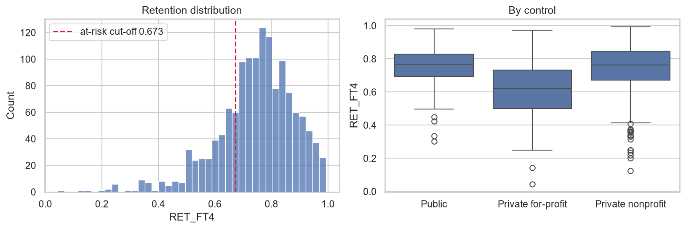
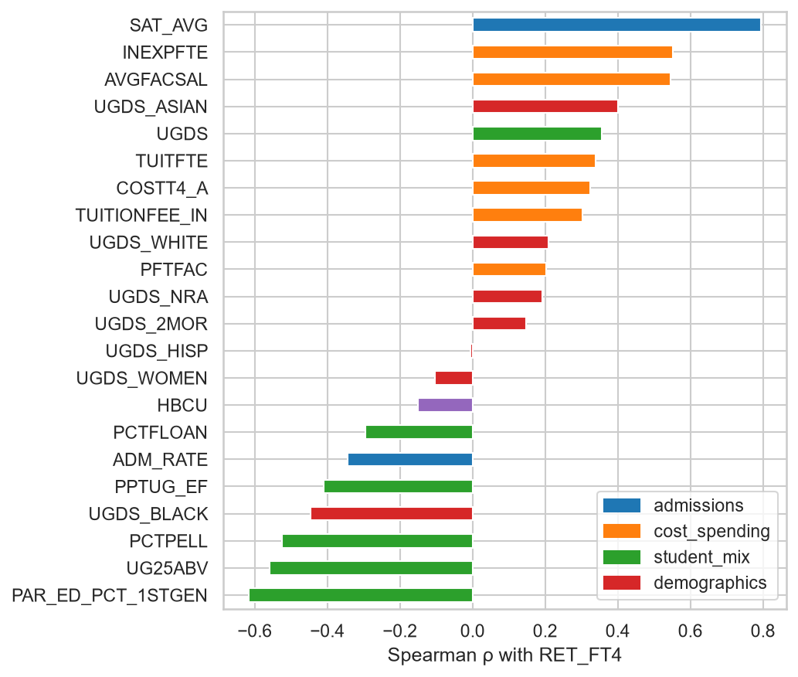

# Which Colleges Are at Risk?
### Predicting first-year student retention at US four-year institutions


Term project for **EECE 5644 Machine Learning and Pattern Recognition**, Northeastern University,
Fall 2026 (Prof. Vinay K. Ingle).
**Team:** Ayussh Srivastav · Meghana Coca

---

## Contents
1. [Overview](#overview)
2. [Results so far](#results-so-far)
3. [Installation](#installation)
4. [Getting the data](#getting-the-data)
5. [Usage](#usage)
6. [Repository structure](#repository-structure)
7. [Methodology](#methodology)
8. [Key data findings](#key-data-findings)
9. [Roadmap](#roadmap)
10. [Team and workflow](#team-and-workflow)
11. [References](#references)

---

## Overview

Nearly one in three US first-year students does not return to the college where they started.
First-year retention is the earliest warning sign that students may not finish, and it varies
enormously between institutions.

Using public US Department of Education **College Scorecard** data, we ask: *given a four-year
college's reported characteristics (admissions, cost and spending, student mix, size and type),
how well can we predict its first-year retention rate, and can we flag the colleges most at risk?*

| | |
|---|---|
| **Unit of analysis** | One row per institution (1,737 four-year colleges) |
| **Task 1: regression** | Predict `RET_FT4`, the share of first-time, full-time students who return for year two |
| **Task 2: classification** | Flag "at-risk" colleges: bottom quartile of retention |
| **Features** | 25 institution characteristics in 5 groups |
| **Models planned** | Ridge/lasso and logistic regression, SVM/SVR, random forest, gradient boosting, optional MLP |
| **Research questions** | (1) How predictable is retention, and which feature groups matter? (2) How should predictions become decisions when missing an at-risk college costs more than a false alarm? (3) Do models work equally well across institution types and without race/ethnicity features? |

> The analysis is at the institution level. It finds associations between college
> characteristics and retention, not causes, and it does not predict individual students.

The full proposal is in [`docs/proposal/`](docs/proposal/EECE5644_proposal_retention.pdf).

---

## Results so far

**Baselines** (training split only, repeated 5-fold cross-validation 5 × 3, mean ± std; the test set is untouched):

| Task | Model | Result |
|---|---|---|
| Retention rate | Predict the mean | MAE 0.105 ± 0.005, R² ≈ 0 |
| Retention rate | Ridge regression (α = 1) | MAE 0.061 ± 0.002, R² 0.59 ± 0.03 |
| Retention rate | Random forest (untuned) | MAE 0.059 ± 0.003, R² 0.61 ± 0.04 |
| At-risk flag | Prior / majority (dummy) | ROC-AUC 0.50, avg. precision 0.25 |
| At-risk flag | Logistic regression (C = 1) | ROC-AUC 0.897 ± 0.014, avg. precision 0.72 |
| At-risk flag | Random forest (untuned) | ROC-AUC 0.906 ± 0.013, avg. precision 0.74 |

Simple models already cut the error by about 40% relative to predicting the average.
Full table: [`results/baselines.csv`](results/baselines.csv).

<p align="center">
  
</p>
<p align="center">
  
</p>

---

## Installation

Requires **Python 3.10+** (developed on 3.12) and git.

```bash
git clone https://github.com/ayussh27/college-retention-risk.git
cd college-retention-risk
python -m venv .venv
```

Activate the virtual environment:

```bash
# Windows (PowerShell)
.venv\Scripts\Activate.ps1
# macOS / Linux
source .venv/bin/activate
```

Install the dependencies:

```bash
pip install -r requirements.txt
```

---

## Getting the data

The cleaned dataset, [`data/processed/cohort.csv`](data/processed/cohort.csv), **is included**, so
you can run the data dictionary, baselines, notebook and tests immediately.

To rebuild it from scratch you need the raw file. It is about 100 MB, so it is not in git:

1. Go to <https://collegescorecard.ed.gov/data/> and download **Most Recent Institution-Level Data**.
2. Unzip `Most-Recent-Cohorts-Institution.csv` into a folder named `Dataset/` in the project root.

This project uses the **October 15, 2026** release (6,278 institutions × 3,379 variables). The
matching official data dictionary is in [`docs/reference/`](docs/reference/).

---

## Usage

Run every command from the project root.

| Command | What it does | Output |
|---|---|---|
| `python -m src.run_all` | Runs the whole pipeline below in order | all of the below |
| `python -m src.run_all --skip-clean` | Same, reusing the included `cohort.csv` (no raw data needed) | |
| `python -m src.clean` | Raw CSV → analysis cohort, train/test split, at-risk label, data checks | `data/processed/cohort.csv` |
| `python -m src.data_dictionary` | Documents every feature from the official dictionary | `docs/data_dictionary.{md,csv}` |
| `python -m src.baselines` | Cross-validated baseline models (about 40 s) | `results/baselines.csv` |
| `python -m pytest` | 10 tests: cohort counts, leakage, split, label, pipeline | pass/fail |
| `jupyter notebook notebooks/01_eda.ipynb` | Exploratory data analysis (Run All) | `results/figures/*.png` |

Expected output of `python -m src.clean`:

```
analysis cohort:          1,737  (train 1,389, test 348)
mean retention:           0.745
at-risk cut-off (train):  RET_FT4 <= 0.6734; at-risk share 0.250
```

**Using the pipeline in your own code:**

```python
from sklearn.pipeline import Pipeline
from sklearn.linear_model import Ridge
from src import config as C
from src.features import load_cohort, make_preprocessor

df = load_cohort()
train = df[df.split == "train"]
model = Pipeline([("prep", make_preprocessor()), ("model", Ridge())])
model.fit(train[C.FEATURES], train[C.TARGET])
```

---

## Repository structure

```
├── src/
│   ├── config.py            # paths, seed, cohort rules, feature groups, leakage list
│   ├── clean.py             # raw CSV -> cohort, split, at-risk label, data checks
│   ├── features.py          # load_cohort() + scikit-learn preprocessing pipeline
│   ├── baselines.py         # dummy / ridge / logistic / random-forest baselines
│   ├── data_dictionary.py   # generates docs/data_dictionary.*
│   └── run_all.py           # runs the full pipeline
├── data/processed/
│   └── cohort.csv           # 1,805 institutions (1,737 analysis + 68 flagged extremes)
├── notebooks/
│   └── 01_eda.ipynb         # exploratory data analysis (training split only)
├── docs/
│   ├── cohort_review.md     # how the cohort was built; which year each variable describes
│   ├── data_dictionary.md   # every feature: meaning, period, missingness, range
│   ├── data_dictionary.csv
│   ├── proposal/            # submitted project proposal (PDF)
│   └── reference/           # official College Scorecard data dictionary (xlsx)
├── results/
│   ├── baselines.csv
│   └── figures/
├── tests/
│   └── test_pipeline.py
├── .github/workflows/tests.yml   # CI: tests + pipeline on every push
├── requirements.txt
└── LICENSE
```

`Dataset/` (raw download) is git-ignored.

---

## Methodology

**Cohort.** Predominantly bachelor's-degree institutions (`PREDDEG = 3`) that report `RET_FT4`:
1,805 colleges. The 68 colleges with retention of exactly 0% or 100% are tiny or unusual; they are
excluded from the main analysis but kept (flagged) for robustness checks. That leaves **1,737**.

**Features (25, in 5 groups used for ablation):**

| Group | Features |
|---|---|
| Admissions | admission rate, average SAT |
| Cost & spending | cost of attendance, in-state tuition, net tuition revenue per student, instructional spending per student, faculty salary, full-time faculty share |
| Student mix | Pell Grant share, federal-loan share, age 25+ share, part-time share, first-generation share, undergraduate enrollment |
| Demographics | race/ethnicity shares, share women *(removed in the fairness experiment E2)* |
| Institution type | public / private nonprofit / for-profit, region, locale (city/suburb/town/rural), HBCU |

**Avoiding leakage and over-optimism**
- **Held-out test set:** a stratified 80/20 split (1,389 / 348). The test set is used **once**, for
  the final model; everything else uses cross-validation on the training set.
- **Preprocessing inside pipelines:** median imputation with missing-value indicators, `log1p` for
  skewed variables, standardization and one-hot encoding are all fitted inside each CV fold.
- **At-risk label from training data:** the cut-off (retention ≤ 0.6734) is the 25th percentile of
  the *training* split.
- **No outcome variables as features:** completion, earnings, debt and repayment variables are
  never inputs. `clean.py` and the tests enforce this.

**Metrics.** Regression: MAE, RMSE, R². Classification: ROC-AUC, average precision, precision,
recall, F1, plus expected cost under a loss matrix (E3).

---

## Key data findings

Details: [`docs/cohort_review.md`](docs/cohort_review.md) · [`docs/data_dictionary.md`](docs/data_dictionary.md)

- **Timing:** retention describes students who entered in **Fall 2023**, but most features describe
  Fall 2024 / 2024-25. The models learn how a college's *current profile* relates to its *recent*
  retention; they are not forecasting from information available before the cohort enrolled.
- **Missing SAT is informative:** 42% of colleges report no SAT average, and they retain 0.685 on
  average against 0.787 for those that do. Hence the missing-value indicators.
- **Small colleges are noisy:** retention varies about twice as much at colleges with 500 or fewer
  undergraduates.
- **Strongest single signals:** SAT average (ρ ≈ +0.8), first-generation share, students aged 25+,
  Pell share (negative), and instructional spending and faculty salary (positive).
- **Data quirks handled:** `PrivacySuppressed` values, faculty salary reported per *month*, the
  first-generation share dating from 2015-17, and empty `PBI`/`HSI` columns.

---

## Roadmap

| Dates (2026) | Milestone | Lead | Status |
|---|---|---|---|
| Oct 4–17 | Literature review, data exploration, proposal | Both | ✅ |
| Oct 18–24 | Repository, cleaning pipeline, data dictionary and cohort review, baselines | Ayussh | ✅ |
| Oct 25–Nov 7 | Ridge/lasso tuning; **E1** feature-group ablation | Meghana | ⏳ |
| Nov 8–21 | SVR/SVM, random forest, boosting tuned; model comparison; at-risk classifier | Ayussh | ⬜ |
| Nov 8–28 | **E2** sensitive features · **E3** cost-sensitive Bayes decisions · **E4** robustness · **E5** error analysis | Meghana | ⬜ |
| Nov 29–Dec 5 | Final figures and tables; full report draft | Both | ⬜ |
| Dec 6–12 | Revision, reproducibility check; final report due **Dec 12** | Both | ⬜ |

---

## Team and workflow

| Member | Focus |
|---|---|
| **Ayussh Srivastav** | data preparation, pipelines, model training |
| **Meghana Coca** | evaluation, decision-theory and fairness analyses, report editing |

Both members review all code and results.

**Working together:**
1. Pull before starting: `git pull`
2. Work on a branch per task: `git checkout -b e1-feature-groups`
3. Before pushing, run `python -m pytest`. CI runs the same tests on GitHub.
4. Open a pull request and have the other member review it before merging to `main`.
5. New experiments go in `src/` (scripts) or `notebooks/` (numbered `02_…`); results go in `results/`.

---

## References

1. National Student Clearinghouse Research Center (2024). *Persistence and Retention* (fall 2022 starting cohort). <https://nscresearchcenter.org>
2. US Department of Education. *College Scorecard* institution-level data and technical documentation. <https://collegescorecard.ed.gov/data/>
3. Bound, J., Lovenheim, M. F., and Turner, S. (2010). Why have college completion rates declined? *American Economic Journal: Applied Economics*, 2(3), 129–157.
4. Alyahyan, E., and Düştegör, D. (2020). Predicting academic success in higher education: literature review and best practices. *International Journal of Educational Technology in Higher Education*, 17(1), 3.
5. Pedregosa, F., et al. (2011). Scikit-learn: Machine learning in Python. *Journal of Machine Learning Research*, 12, 2825–2830.

**Data license:** College Scorecard data are US government works in the public domain.
**Code license:** [MIT](LICENSE).
